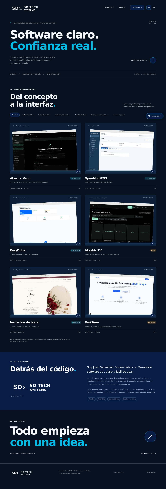

# SD Tech Systems

Portafolio de software y desarrollo web de SD Tech Systems. Presenta soluciones para ventas, administración de negocios, asistentes de IA locales y sitios a medida, con información en español e inglés.

[Visitar el portafolio](https://sdtechsystems.dev/)



## Proyectos y demostraciones

Cada proyecto incluye su propósito, funciones, tecnologías y estado de desarrollo. Las categorías permiten explorar puntos de venta, software ERP, aplicaciones a medida y páginas web.

Las demostraciones permiten recorrer una caja, administrar inventario de ejemplo, explorar asistentes locales, navegar un catálogo de televisión y conocer el concepto de TaskTone. La muestra de invitación incluye una web completa con historia, eventos y confirmación de asistencia simulada.

Las demos usan datos ficticios y conservan los cambios en memoria. No procesan pagos, ejecutan modelos de IA ni envían confirmaciones reales. Sus funciones ilustran el producto; cada ficha indica el alcance de la aplicación correspondiente.

El sitio se adapta a móviles y permite ajustar tamaño de texto, contraste, espaciado, enlaces y movimiento. Está disponible en [español](https://sdtechsystems.dev/es/) e [inglés](https://sdtechsystems.dev/en/).

## Ejecutar el sitio

Requiere Node.js 22.12 o posterior y npm.

```sh
npm ci
npm run dev
```

Astro muestra la dirección local, normalmente `http://localhost:4321`.

```sh
npm run build
npm run preview
```

La compilación genera el sitio estático en `dist/`. Para alojarlo bajo `/portfolio/`:

```sh
PAGES_BASE=/portfolio/ npm run build
```

En PowerShell, usar `$env:PAGES_BASE='/portfolio/'` antes de `npm run build`.

## Contenido y mantenimiento

Los proyectos se editan en `src/data/projects.ts` y `src/data/projects-en.ts`. Las categorías y los datos de contacto están en `src/data/catalog.ts`.

- [Guía de configuración](docs/CONFIGURACION.md).
- [Funcionamiento de las demos](docs/DEMOS_SOFTWARE.md).
- [Vista móvil](docs/preview-mobile.png) y [copia navegable sin instalación](docs/vista-previa.zip).

Para comprobar las demos, instalar Chromium con `npx playwright install chromium`, compilar con `npm run build` y ejecutar `npm run test:demos`.

## Licencia

El código del portafolio se distribuye bajo [AGPL-3.0](LICENSE). Los productos presentados, recursos y componentes de terceros conservan sus propias licencias.
